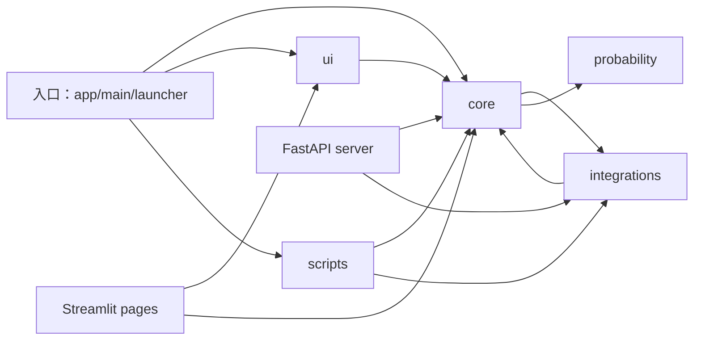
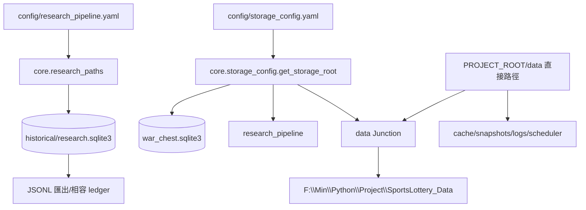

# Sportslottery 架構盤點

**基準分支：** `dev`

**基準提交：** `831e048aeda578c98c4ffaa44d805e9329d0b6ec` (`Fix radar initialization and sheet visibility`)

**盤點日期：** 2026-11-02
**範圍：** 靜態程式碼、設定、測試與 CI；本文件不代表正式資料或即時市場驗收。

## 判讀方式

此文件只把目前程式碼與可重現檢查當成證據。資料來源是否真實、前瞻模型是否有優勢、Windows 長時間運作及外部 LINE 收發，仍需各自的執行環境驗收。LOC 與 import 數只用來定位責任，不單獨構成拆檔理由。

## Application Entry Points

| 入口 | 實際作用 | 主要證據 | 備註 |
| --- | --- | --- | --- |
| `main.py` | CLI 執行備份、還原、結算、報告、盤口監看、資料匯出與研究 pipeline；無子命令時啟動 Streamlit `app.py` | `main.py:26-130` | 保留的舊版/直接開發入口 |
| `app.py` | Streamlit 頁面與直接服務組裝 | `app.py:28-123` | 與 FastAPI 的服務組裝不共用同一個 container |
| `launcher.py` | 啟動系統匣管理器 | `launcher.py:45-84`; `scripts/tray_manager.py:413-485` | 現代 FastAPI + React + LINE 執行路徑；tray 以單一 Uvicorn worker 啟動 |
| `server/api.py` | FastAPI app、lifespan、服務初始化、HTTP/LINE routes、靜態前端掛載 | `server/api.py:93-206, 1879-1887` | 目前 API composition 與多數 endpoint 集中於單一模組 |
| `desktop_launcher.py` | 直接啟動 Streamlit，供目前 PyInstaller distribution 使用 | `desktop_launcher.py:106-167`; `sportslottery_dist.spec:67-72` | 與 README 推薦的 Tray 執行路徑不同 |
| `scripts/dev_runner.py` | 開發環境建置前端並啟動 tray | `scripts/dev_runner.py:123-154` | 目前會管理固定 port 的既有程序，屬本機操作風險 |
| `scripts/serve_line_bot.py`, `scripts/line_webhook_server.py` | 相容入口，轉交 tray 管理器 | `scripts/line_webhook_server.py:194-198` | legacy webhook 模組仍有測試引用 |
| `main.py research-pipeline` / Windows 工作排程器 | 執行隔離研究 pipeline | `main.py:75-92`; `core/storage_config.py:345-395` | 與 Market Scheduler 是不同流程與資料根目錄 |

目前有兩種 UI 執行堆疊：FastAPI/React 的常駐服務，以及 Streamlit 舊介面。README 將 Tray/FastAPI 描述為推薦路徑；但 release workflow 執行 `build_windows.ps1`，後者以 `sportslottery_dist.spec` 打包 `desktop_launcher.py`，目前產物是 Streamlit 堆疊。此處是發行流程與文件的明確不一致；在選定套件行為並做可執行 smoke test 前，不應刪除任一入口或任一 PyInstaller spec。

## 主要模組依賴圖

以下是對 150 個 production Python 模組進行 AST import 掃描的 package-level 邊數；排除 `tests/`、`artifacts/` 與前端。這表示靜態 import 出現次數，不是 runtime 呼叫次數。

Import 邊數：`core→integrations 41`、`integrations→core 22`、`server→core 26`、`server→integrations 4`、`scripts→core 49`、`scripts→integrations 12`、`ui→core 16`、`entrypoint→core 29`。`core` 與 `integrations` 雙向依賴是最重要的層級反轉：例如 core 直接建構 Playsport、Odds API 與 Result adapters；integration 又依賴 core 的 scraper、身份對齊與 persistence。

靜態模組圖找到三組 strongly connected components：

1. `core.edge_engine` ↔ `core.probability_evidence`：機率邊界與 evidence evaluator 互相取得型別／功能。
2. `core.research_pipeline`、`core.research_mlb`、`core.research_reporting`：pipeline 拆成 mixin 後，mixin 仍在執行期回頭匯入主 pipeline helper。
3. `core.market_forward_pipeline` ↔ `core.market_scheduler`：市場流程與排程狀態／啟動協調互相引用。

`core.model_registry.py:79` 另有 `importlib.import_module` 動態模型載入。AST 圖無法推論它的完整 runtime graph；新增架構守門時需將設定式 adapter 載入列為例外邊界。

## 核心研究與推薦資料流

```mermaid
flowchart LR
  Taiwan[Playsport 台彩盤] --> Candidate[MarketForwardPipeline 候選資格]
  Candidate -->|有效聯賽與玩法| Odds[The Odds API]
  Odds --> Snapshot[MarketOddsSnapshot]
  Candidate --> Aligner[MarketAligner]
  Snapshot --> Aligner
  Aligner --> Benchmark[MarketBenchmarkEvidence]
  Candidate --> Signal[SignalHub]
  Benchmark --> Signal
  Signal --> Forecast[預測與 EV 證據]
  Forecast --> Logger[PredictionSnapshotLogger：hash/lineage]
  Logger --> Settle[settle_snapshot_results / SettlementEngine]
  Settle --> Evaluation[ForwardEvaluationEngine]
```

目前市場流程可見於 `core/market_forward_pipeline.py:521-755`，賽後結算入口在 `:807` 附近，評估器在 `core/forward_evaluation_engine.py:345`。有效候選查詢與後續分析已由混合新鮮/過期候選測試覆蓋（`tests/test_market_forward_pipeline.py:396-410`）；這是離線程式證據，不是實盤配對證據。

另外有獨立的 Research Pipeline：`core/research_pipeline.py:435` 執行隔離 run，`:_stage_pregame_snapshots`（`core/research_pipeline.py:632`）以台彩、SignalHub 與模型訊號建立研究快照；它與 MarketForwardPipeline 使用不同 orchestration 與資料目錄，目前不會把 Odds API benchmark 注入同一套前瞻流程。不得把兩條流程或兩組 snapshot 樣本混稱為同一個市場驗證 cohort。

### 研究可信度與來源邊界

- Market 主路徑把 `MarketBenchmarkEvidence` 傳入 `SignalHub.evaluate_taiwan_leg()`，Sharp 是該 typed market evidence 的來源資格層，不是額外獨立投票。
- `SharpBenchmarkOddsAdapter` 仍在 `SignalHub` 建構介面，但主 pipeline 的實際接線使用 `MarketBenchmarkEvidence`；需先確認所有相容呼叫後再決定是否退役。
- `audit_snapshots()`、Snapshot hash、forward evaluation eligibility 與 event-level dedupe 存在實作；N 與指標仍需依合格樣本判讀，不代表模型已證明優勢。
- UI 已把 API 連線、國際盤資料與配對狀態分開呈現，並提示離線 fixture 不等於實盤配對（`frontend/src/views/ResearchView.tsx:195-205, 330`）。
- 尚有一項來源封存風險：Odds API parser 對缺少 provider `id` 會形成字串 `"None"`，缺少 `commence_time` 則用擷取時間代替（`integrations/odds/the_odds_api.py:729-735`）；若該資料進入後續流程，缺值就不再可辨識。應於邊界 fail closed 並以 fixture 驗證。
- MarketForward 候選閘門與 `core.bet_validation.assess_leg()` 不完全相同：前者要求 fresh 標籤和可解析開賽時間，但沒有共用後者的「已開賽」及 `identity_incomplete` 檢查（`core/market_forward_pipeline.py:188-251`；`core/bet_validation.py:65-104`）。資格規則需在後續 market/domain milestone 對齊，並保留差異原因。

## SQLite、JSONL 與檔案路徑

本機 `data` 是 Windows Junction，目標為 `F:\Min\Python\Project\SportsLottery_Data`；`config/storage_config.yaml` 指向相同位置。錢包 DB 主要經 `core.storage_config.get_db_path()`；研究 ledger 由 `core.research_paths.research_paths()` 解析並拒絕與專案／保護目錄重疊。多個舊 cache、scraper、scheduler 與 log 路徑直接使用 `PROJECT_ROOT/data`，目前依賴 Junction 與 `get_storage_root()` 匯流。不能在重構中移除 Junction 或用另一個 root 取代而不逐條搬遷／驗收路徑。

資料保護的重要實作：

- `core/persistence.py` 提供跨程序檔案鎖、暫存檔原子替換與 JSONL 操作。
- `core/research_sqlite.py` 管理研究 ledger 的 SQLite 使用；既有 JSONL import/export 路徑需保留。
- `core/backup_service.py` 使用 SQLite Online Backup API，對備份檔做完整性與 hash 驗證。
- `core/wallet.py`、`core/ticket_recorder.py` 使用交易保護帳本與注單一致性。
- `core/storage_config.update_storage_location()` 會複製資料、更新設定、改 Junction 及同步 Scheduled Task。此高影響流程本次沒有執行；禁止拿 live F: 資料做重構測試。
- `wallet.py` / `profile_manager.py` 有 import-time DB path；`server/auth.py` 每次連線重新解析 DB path。若執行中變更 storage config，既有服務可能分別連到不同 DB。目標做法是啟動時固定同一個解析結果並要求 restart，或明確注入同一組 storage paths；不在此次動到正式資料。

## 模組責任與高耦合

| 範圍 | 現有責任 | 架構觀察 |
| --- | --- | --- |
| `core/market_forward_pipeline.py` (~1,204 LOC) | market fetch orchestration、資格、API 成本、配對、benchmark、SignalHub、snapshots、settlement 與 report | orchestration 和 market policy 混合；候選/benchmark/結算可用 seams 漸進抽離 |
| `core/research_pipeline.py` (~881 LOC) + `research_mlb.py` + `research_reporting.py` | run orchestration、MLB warmup、報告、快照與結算階段 | mixin 導致主模組反向匯入 cycle；以可注入 stage/service 取代隱含 `self` helper 前須先建立 Golden replay |
| `core/signal_hub.py` (~707 LOC) | source adapters、模型、lineage 去重、機率與證據組裝 | 清楚的決策 seam 是 typed benchmark evidence 與輸出 evidence；保留目前數學及來源政策 |
| `core/market_aligner.py` (~691 LOC) | 聯賽、隊名、事件時間、玩法、選邊、盤線與報價時間比對 | 多個識別/盤線責任，但規則緊密互依；先以 fixtures 建立市場等價測試再拆 |
| `integrations/odds/the_odds_api.py` (~1,041 LOC) | HTTP、cache/lock、配額、backoff、解析、fixture fallback 與 status | provider adapter 聚合多項 infrastructure 職責；quota/TTL/official headers 必須保留 |
| `server/api.py` (~1,887 LOC) | FastAPI setup、services、middleware、request models、39 routes、LINE webhook 和 React 靜態檔 | endpoint 很多，response schema 與前端 TS 型別各自維護；已有安全的鎖定初始化，先抽 router 並維持 app import facade |
| `app.py` (~2,018 LOC) | Streamlit shell、navigation、service cache 與 page composition | 與 FastAPI 有另一套 service composition；維持相容，避免把 UI 遷移混進 backend 拆分 |
| `core/snapshot_logger.py`, `core/settlement_engine.py`, `core/forward_evaluation_engine.py` | immutable hash/append、結果比對/玩法結算、統計評估 | 資料可信度與資格邊界；先保留其檔案與 schema，優先補 contract tests |
| `core/profile_manager.py`, `core/wallet.py`, `core/ticket_recorder.py` | identity、每週預算、注單 transaction | 使用者資產路徑；保留 DB transaction、Session/Admin isolation 與現行 schema |

### 主要重複規則／手寫合約

1. 候選 ready 規則分布於 MarketForward `_candidate_rejection_reason`、`bet_validation.assess_leg`、snapshot cutoff/hash 與 forward evaluation cohort gate。它們服務不同階段，但同一 event/time/identity 語意必須明確共用或說明差異。
2. Event/team/league normalization 分布於 `core/identity/*`、MarketAligner、candidate query mapping、settlement providers；時間容差也不同（MarketAligner、`EventMatcher`、settlement match）。共享的是 canonical identity，並非把所有時間容差硬改成同一數字。
3. `server/api.py` response dictionaries 與 `frontend/src/types/index.ts` 手工型別重複；`frontend/src/services/api.ts` 只對部分 endpoints 有 request/query typing。
4. FastAPI `get_services()` (`server/api.py:162-206`) 與 Streamlit `@st.cache_resource` (`app.py:100-123`) 分別組裝業務 services。
5. LINE callback 主實作在 `server/api.py`，相容舊 module 仍含另一份 handler/verification 流程；目前 direct legacy entry 轉交 tray，但測試仍引用舊 app。

## 目前已驗證的最新 hardening 基線

使用者提供的第二輪審查建議先做四項 hardening。`dev` 後續提交 `5cf0209` 已將其納入目前 `831e048`：

| 審查建議 | 目前程式碼證據 | 判斷 |
| --- | --- | --- |
| 過期／無效台彩候選不得進後續市場分析 | `core/market_forward_pipeline.py:541-603, 689-752`; 混合 fresh/stale regression `tests/test_market_forward_pipeline.py:396-410` | stale 標籤案例已修；更完整的 `identity_incomplete`/started-event 規則仍待統一 |
| 最大回撤不得假稱百分比 | `compute_max_drawdown_amount()` 與 `pnl_drawdown_amount`，`core/forward_evaluation_engine.py:49,151-165,533`; `tests/test_forward_evaluation.py:104,121-122` | 已改為金額 |
| CI 納入市場整合與評估測試 | `.github/workflows/ci.yml:54-58` | 已納入；仍是 fixture/mock 離線驗證 |
| UI 區分 API、盤口、配對狀態 | `frontend/src/views/ResearchView.tsx:195-205,330` | 已分開呈現；真實市場配對仍未在此環境驗收 |

## CI、測試與 build 基線

- Baseline HEAD `831e048aeda578c98c4ffaa44d805e9329d0b6ec` 與 `origin/dev` 相同；開始盤點時工作樹無程式碼變更。
- GitHub Actions run `41554163744` 對應此 HEAD 並成功（跨平台 CI）；其工作流仍只執行明列的核心測試清單，不是 `pytest` 全部 599 items。
- `.github/workflows/ci.yml` 目前 Windows/Ubuntu 都建置 React，並執行 security、wallet/ticket、API、scheduler、market alignment/benchmark/forward tests；真實網路測試由 `tests/conftest.py` 預設阻擋或 skip。
- 前端獨立 `npm run build` 已在暫存輸出目錄完成：TypeScript build 與 Vite production bundle 成功；沒有覆寫現有 `frontend/dist`。
- Python 完整 suite 收集 599 items。Windows 沙盒預設 `%TEMP%` 下，atomic `os.replace()` 測試曾收到 Access Denied；同一個測試改用 workspace 內隔離 `--basetemp` 後通過。之後完整 suite 在 `tests/test_line_webhook_server.py::test_webhook_root_endpoint` 停滯；獨立 FastAPI 最小 app 的 `TestClient` 呼叫亦會停滯，因此目前不能歸因於 Sportslottery endpoint 或宣稱完整 suite 通過。基線結果為「未完成／本機測試環境待診斷」，既有 CI 僅涵蓋明列測試清單且成功。
- 本機 Starlette 版本為 `1.3.1`，同環境有 `httpx 0.28.1`、沒有 `httpx2`；Starlette 官方文件現建議 TestClient 使用 `httpx2`，但尚無證據證明缺少它就是本機停滯原因。M8 dependency governance 應固定 FastAPI/Starlette/TestClient 的可重現測試相依性，並以 CI 驗證，不要只因本機症狀就盲目升級依賴。
- CI 依序安裝 `requirements-lock.txt` 與寬鬆版 `requirements.txt`；後者中的 FastAPI、Starlette transitives、Uvicorn、httpx、Pydantic 目前沒有完整鎖定在 lock file。這造成 CI runner 可能隨上游新版本改變。將鎖檔完整性列為 M8，不在架構盤點階段直接更新套件。
- `tests/conftest.py` patch wallet/profile DB 到 temp，並封鎖 Requests 與 `urllib.request.urlopen`；市場／研究快照測試使用 fixture 與明確 temp path。帶 `data/` 的 MLS fixture 測試只讀既有資料。

## 暫不重構的穩定元件

- Profile/Auth 的固定 profile ID 權限判斷、Session token hash 和密碼 hash；已通過最近安全修復基線，不重新設計權限模型。
- Wallet、TicketRecorder 交易與 SQLite 現有 Schema。
- `research_paths` 保護目錄檢查、JSONL file lock/atomic replace、研究 SQLite ledger 與 SQLite 線上備份驗證。
- `TaiwanLeg`、`MarketOddsSnapshot`、`MarketBenchmarkEvidence`、snapshot hash/lineage 等現有 wire/persistence contract。需要移動時加相容 re-export，不做欄位或數學語意改名。
- Odds API 跨程序 cache、TTL、quota headers、50-credit reserve 與 call-cost accounting。
- React Sheet Portal、路由/頁面操作與兩個啟動 UI 的現有入口，直到 build/runtime mismatch 有實測決策。

## 盤點決策

先建立 target architecture/ADR，再選擇小而可測的結構 seam。第一批程式重構優先處理 API router boundary 與 market/research eligibility contract；storage path、Windows packaging 和 live research data 只做只讀驗證，除非存在 isolated fixture 與明確 rollback。不能用拆檔數量或降低 LOC 當成完成指標。
