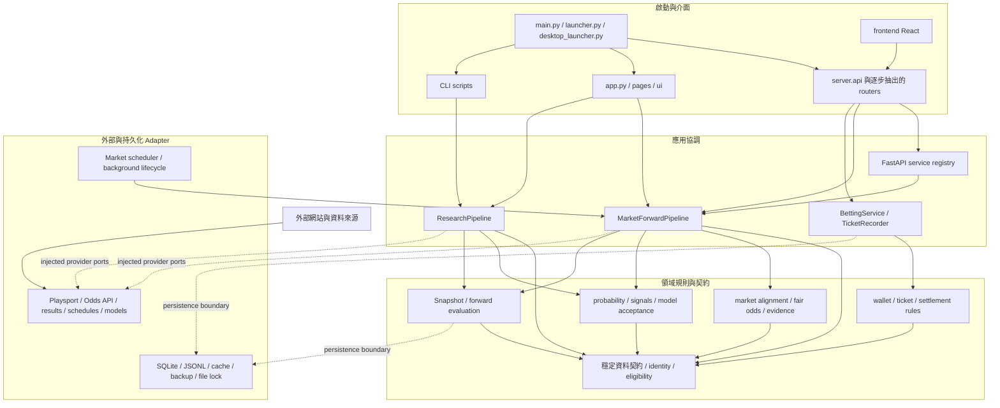

# Sportslottery 目標架構與遷移圖

**狀態：** M2 決策基線；按 M3–M9 驗證後更新
**依據：** [架構盤點](00-discovery.md)；目前實作仍以既有目錄為準。

## 設計目標

將 Sportslottery 維持為單一部署、單一程式碼庫的 Modular Monolith。改動以責任邊界、依賴方向與資料契約為準，不以建立新目錄或降低行數為目標。既有模組在遷移期間可留在原路徑，舊匯入名稱可透過相容 Facade 繼續提供。

虛線表示透過建構時注入的 adapter 或小型 protocol 呼叫。目標不要求一次建立完整 `domain/`、`application/`、`infrastructure/` 樹；先在現有 `core/`、`integrations/`、`server/` 建立可驗證的邊界，只有當多個實際呼叫者需要時才搬移模組。

## 責任與依賴規則

| 邊界 | 責任 | 允許的依賴 | 不允許的新依賴 |
| --- | --- | --- | --- |
| Entrypoints | 解析命令列／桌面啟動、建構單一執行堆疊 | Presentation 與應用組裝入口 | 核心計算細節或另一 UI 堆疊內部 |
| Presentation | HTTP、React／Streamlit UI、序列化與認證入口 | 應用服務、公開 request/response contract | 自行實作賠率、資格、結算或模型接受規則 |
| Application orchestration | 協調抓取、研究、下注、結算、排程流程 | 領域規則、ports/contracts、已組裝 adapters | 直接 new provider client 或反向依賴 HTTP/UI |
| Domain policy | identity、market eligibility、機率、EV、下注與結算規則 | 標準函式庫及已核准的數值依賴、領域契約 | FastAPI、React、SQLite、檔案路徑、網路 client |
| Provider adapters | 對外部網站/API/模型/賽果來源做轉換與來源紀錄 | 穩定資料契約、HTTP/解析函式庫、共用低階 I/O | 呼叫 pipeline、SignalHub 或 API route |
| Storage/runtime adapters | SQLite、JSONL、cache、lock、backup、scheduler lifecycle | 穩定資料契約與設定 | 推導市場資格或模型結果 |

額外規則：

1. `server.api` 是 FastAPI app 與相容匯入入口；新 route 依領域放入 router 模組，不能另建第二個 app。
2. `get_services()` 的鎖、一次性初始化與完整 bundle 發布必須保持原子性。各 router 使用同一個應用生命週期中的服務實例。
3. `MarketForwardPipeline` 與 `ResearchPipeline` 是不同 cohort 的流程。可共用 policy 與資料型別，但不可合併其輸出、資料根目錄或統計樣本。
4. Provider 原始欄位、UTC 開賽時間、擷取時間、market-level quote time、Synthetic 標記與資格原因必須在 adapter 邊界保留；缺資料不能以預設值假造。
5. Wallet、TicketRecorder、Session、snapshot hash/lineage、The Odds API quota/cache/lock 與既有 SQLite schema 都是相容性邊界。
6. 既有 legacy import 若仍有測試或外部呼叫，先讓舊模組轉匯出新實作，確認呼叫者遷移後再評估移除。

## 遷移順序與驗收切面

| 後續 milestone | 先處理的 seam | 最小驗收 | 回退方式 |
| --- | --- | --- | --- |
| M3 API lifecycle | 服務組裝與 router 邊界；先保留 `server.api.app`、符號與 route | OpenAPI path/method/schema、Auth/Admin/Wallet、並行初始化及 lifespan 測試 | 復原單一 composition module；不碰資料庫 |
| M4 Market boundaries | candidate eligibility、provider 注入、benchmark→SignalHub 順序 | 固定 fixture 對候選、對齊、fair probability、訊號/EV、snapshot 的業務欄位做 replay diff | 舊 pipeline 仍可由 facade 呼叫；只回退程式，不重寫 snapshots |
| M5 Shared contracts | event identity、market/selection/line contract、重複 eligibility 與循環 import | 舊/新序列化等價、cycle 清單縮減、所有既有 consumer 測試 | 由舊路徑 re-export 型別與函式 |
| M6 Storage safety | 固定啟動時解析的 path bundle、隔離 storage boundary；不遷移正式資料 | temp SQLite／JSONL、Junction path resolution、lock/transaction/backup tests | 關閉新 adapter 使用並回到舊 helper；schema 與檔案原地不動 |
| M7 UI/API contracts | 以 FastAPI OpenAPI 作 API 基準，逐段對齊手寫 TS 型別 | response compatibility、React build、Sheet/Radar/主要頁面回歸 | 舊 endpoint 與前端呼叫保留 |
| M8 Governance | dependency/import boundary tests、權威文件與鎖檔規則 | 邊界負向測試、lock-file 安裝、CI 不讀正式資料 | 先移除守門測試，不改 runtime 行為 |
| M9 Delivery | 完整跨平台 regression 與 launcher/packaging smoke checks | 全套離線測試、frontend build、Windows/Linux CI、diff 與 secret scan | 以逐 milestone commit 回退；不 force-push、不清除資料 |

### Golden replay 比較範圍

M4/M5 應使用版本控制中的離線 fixture，不呼叫正式 Odds API。比較時正規化執行時間與隨機 ID，但不忽略候選通過狀態、事件 ID、對齊狀態、盤線、公允機率、EV、來源 lineage、snapshot hash 輸入、結算 outcome 或評估指標差異。若輸入 fixture 不足以涵蓋某種市場，紀錄為未驗證，不以人工預期補成通過。

## 明確保持原狀的項目

- 不因目標架構而拆成微服務或更換 FastAPI、React、Streamlit、SQLite。
- 不把 `core/` 全部搬到新目錄；先解除循環與 adapter 反向依賴，再依實際使用者搬動。
- 不重寫 Parlay 排序、相關性折扣、EV、Brier、ROI、CLV 或模型接受公式。
- 不統一不同 cohort 的資料庫、快照、排程、樣本數或結算策略。
- 不刪除另一套啟動入口、LINE 相容模組或打包檔，除非 M9 實際 smoke test 證明已無用途且可回退。
- 不複製、遷移或寫入 `data` Junction 指向的正式目錄。

## 架構決策紀錄

- [ADR-0001：漸進式 Modular Monolith](adr/0001-modular-monolith.md)
- [ADR-0002：持久化與相容性邊界](adr/0002-data-and-compatibility-boundaries.md)
- [ADR-0003：市場證據與前瞻 cohort 邊界](adr/0003-market-evidence-boundary.md)
