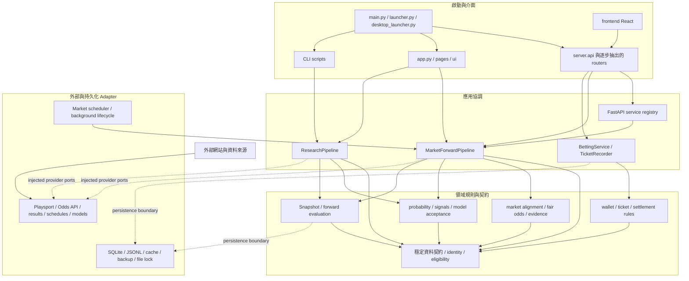

# Sportslottery 目標架構與遷移圖

**狀態：** M2 決策基線；按 M3–M9 驗證後更新
**依據：** [架構盤點](00-discovery.md)；目前實作仍以既有目錄為準。

## 設計目標

將 Sportslottery 維持為單一部署、單一程式碼庫的 Modular Monolith。改動以責任邊界、依賴方向與資料契約為準，不以建立新目錄或降低行數為目標。既有模組在遷移期間可留在原路徑，舊匯入名稱可透過相容 Facade 繼續提供。

虛線表示透過建構時注入的 adapter 或小型 protocol 呼叫。目標不要求一次建立完整 `domain/`、`application/`、`infrastructure/` 樹；先在現有 `core/`、`integrations/`、`server/` 建立可驗證的邊界，只有當多個實際呼叫者需要時才搬移模組。

## 責任與依賴規則

| 邊界 | 責任 | 允許的依賴 | 不允許的新依賴 |
| --- | --- | --- | --- |
| Entrypoints | 解析命令列／桌面啟動、建構單一執行堆疊 | Presentation 與應用組裝入口 | 核心計算細節或另一 UI 堆疊內部 |
| Presentation | HTTP、React／Streamlit UI、序列化與認證入口 | 應用服務、公開 request/response contract | 自行實作賠率、資格、結算或模型接受規則 |
| Application orchestration | 協調抓取、研究、下注、結算、排程流程 | 領域規則、ports/contracts、已組裝 adapters | 直接 new provider client 或反向依賴 HTTP/UI |
| Domain policy | identity、market eligibility、機率、EV、下注與結算規則 | 標準函式庫及已核准的數值依賴、領域契約 | FastAPI、React、SQLite、檔案路徑、網路 client |
| Provider adapters | 對外部網站/API/模型/賽果來源做轉換與來源紀錄 | 穩定資料契約、HTTP/解析函式庫、共用低階 I/O | 呼叫 pipeline、SignalHub 或 API route |
| Storage/runtime adapters | SQLite、JSONL、cache、lock、backup、scheduler lifecycle | 穩定資料契約與設定 | 推導市場資格或模型結果 |

額外規則：

1. `server.api` 是 FastAPI app 與相容匯入入口；新 route 依領域放入 router 模組，不能另建第二個 app。
2. `get_services()` 的鎖、一次性初始化與完整 bundle 發布必須保持原子性。各 router 使用同一個應用生命週期中的服務實例。
3. `MarketForwardPipeline` 與 `ResearchPipeline` 是不同 cohort 的流程。可共用 policy 與資料型別，但不可合併其輸出、資料根目錄或統計樣本。
4. Provider 原始欄位、UTC 開賽時間、擷取時間、market-level quote time、Synthetic 標記與資格原因必須在 adapter 邊界保留；缺資料不能以預設值假造。
5. Wallet、TicketRecorder、Session、snapshot hash/lineage、The Odds API quota/cache/lock 與既有 SQLite schema 都是相容性邊界。
6. 既有 legacy import 若仍有測試或外部呼叫，先讓舊模組轉匯出新實作，確認呼叫者遷移後再評估移除。

## 遷移順序與驗收切面

| 後續 milestone | 先處理的 seam | 最小驗收 | 回退方式 |
| --- | --- | --- | --- |
| M3 API lifecycle | 服務組裝與 router 邊界；先保留 `server.api.app`、符號與 route | OpenAPI path/method/schema、Auth/Admin/Wallet、並行初始化及 lifespan 測試 | 復原單一 composition module；不碰資料庫 |
| M4 Market boundaries | candidate eligibility、provider 注入、benchmark→SignalHub 順序 | 固定 fixture 對候選、對齊、fair probability、訊號/EV、snapshot 的業務欄位做 replay diff | 舊 pipeline 仍可由 facade 呼叫；只回退程式，不重寫 snapshots |
| M5 Shared contracts | event identity、market/selection/line contract、重複 eligibility 與循環 import | 舊/新序列化等價、cycle 清單縮減、所有既有 consumer 測試 | 由舊路徑 re-export 型別與函式 |
| M6 Storage safety | 固定啟動時解析的 path bundle、隔離 storage boundary；不遷移正式資料 | temp SQLite／JSONL、Junction path resolution、lock/transaction/backup tests | 關閉新 adapter 使用並回到舊 helper；schema 與檔案原地不動 |
| M7 UI/API contracts | 以 FastAPI OpenAPI 作 API 基準，逐段對齊手寫 TS 型別 | response compatibility、React build、Sheet/Radar/主要頁面回歸 | 舊 endpoint 與前端呼叫保留 |
| M8 Governance | dependency/import boundary tests、權威文件與鎖檔規則 | 邊界負向測試、lock-file 安裝、CI 不讀正式資料 | 先移除守門測試，不改 runtime 行為 |
| M9 Delivery | 完整跨平台 regression 與 launcher/packaging smoke checks | 全套離線測試、frontend build、Windows/Linux CI、diff 與 secret scan | 以逐 milestone commit 回退；不 force-push、不清除資料 |

### Golden replay 比較範圍

M4/M5 應使用版本控制中的離線 fixture，不呼叫正式 Odds API。比較時正規化執行時間與隨機 ID，但不忽略候選通過狀態、事件 ID、對齊狀態、盤線、公允機率、EV、來源 lineage、snapshot hash 輸入、結算 outcome 或評估指標差異。若輸入 fixture 不足以涵蓋某種市場，紀錄為未驗證，不以人工預期補成通過。

## 明確保持原狀的項目

- 不因目標架構而拆成微服務或更換 FastAPI、React、Streamlit、SQLite。
- 不把 `core/` 全部搬到新目錄；先解除循環與 adapter 反向依賴，再依實際使用者搬動。
- 不重寫 Parlay 排序、相關性折扣、EV、Brier、ROI、CLV 或模型接受公式。
- 不統一不同 cohort 的資料庫、快照、排程、樣本數或結算策略。
- 不刪除另一套啟動入口、LINE 相容模組或打包檔，除非 M9 實際 smoke test 證明已無用途且可回退。
- 不複製、遷移或寫入 `data` Junction 指向的正式目錄。

## M3 實作紀錄

`server.api` 現在只負責 FastAPI app、middleware、router 組裝、靜態資產與相容匯出。路由依責任位於 `server/routers/market.py`、`parlay.py`、`wallet.py`、`identity.py`、`research.py`、`line.py`；request model 移至 `server/schemas.py`，服務組裝移至 `server/service_registry.py`，排程 lifespan 移至 `server/lifecycle.py`。舊的 `server.api:app`、常用 handler、request model 與錢包 helper 匯入仍可使用。

API 回歸以 M2 原始 OpenAPI 所列的 38 組 path/method 為基準；新增 `tests/test_api_contract.py` 檢查路徑、方法及關鍵 request model reference，`tests/test_service_registry.py` 檢查多執行緒只初始化一份完整服務與初始化失敗不發布半成品。API router 的整合回歸仍由既有 Auth、Admin、Wallet、Market、Scheduler 測試負責。

詳細實作邊界見 [API 與生命週期](02-api-boundaries.md)。

## M4 實作紀錄

`MarketForwardPipeline` 保留既有呼叫入口；候選資格規則移到 `core/market_candidate_policy.py`，由 orchestration 傳入市場映射與聯賽查詢解析器。國際查詢的 provider league capability 由建構時可注入的 `MarketProviderCapabilities` 提供。預設 Playsport／Odds API adapter 只在相容入口缺少 provider 時，透過 `core/market_provider_factory.py` 建立；兩個 provider 都已注入時不建立預設 client。

市場流程維持「資格檢查 → 依有效候選查詢 → 事件／玩法／線位／時間對齊 → 建立完整市場基準 → 將基準傳入 SignalHub → 寫入 snapshot」的順序。`tests/fixtures/market/mlb_moneyline_replay.json` 與 `tests/test_market_golden_replay.py` 以固定時間離線回放此路徑，並檢查有效候選、真實匹配、公允機率、EV、來源資格、snapshot 資格及 hash 對應欄位。混合有效與過期候選的回歸測試確認過期項目不會進入對齊、SignalHub 或 snapshot。

目前 golden fixture 證明的是 MLB 兩向不讓分的離線流程；它不替代即時來源或其他聯賽的環境驗收。Spread、Total、足球三向盤的市場數學另由既有離線整合測試覆蓋。回退 M4 可只回退程式及測試提交；沒有改寫既有 snapshots 或正式資料。

詳細邊界見 [市場資料邊界與離線回放](03-market-boundaries.md)。

## M5 實作紀錄

共用且不依賴框架的資料契約已移至 `core/contracts/`。Core 服務直接匯入預測訊號、台彩賽事、國際市場證據與機率評估型別；舊的 `integrations.common.models` 與 `integrations.odds.market_models` 保留為相容 facade，重新匯出相同型別物件，維持舊呼叫者與序列化格式。

市場對齊與基準準備共用 `MarketSelectionIdentity` 及其線位規則，統一同側與對手盤的比較。Provider 解析仍屬於 `integrations/`，流程協調仍屬於 `core/`。

研究序列化、MLB 賽程核對及 payload 轉換 helper 已移至 `core/research_helpers.py`。MLB 與報表 mixin 不再反向匯入 `ResearchPipeline` 取得 helper。市場排程狀態由注入 provider 傳給 `MarketForwardPipeline`；機率 evidence 直接使用獨立的結果契約，不再匯入 edge engine。靜態 import graph 檢查顯示原先 edge/probability、market/scheduler、research 模組群的循環依賴已解除。

預設測試 fixture 也將 Shadow Portfolio SQLite 與快照路徑導向每次測試的暫存目錄，避免觸及正式 `data` Junction。CI 新增契約相容與依賴邊界測試。詳細規則見[共用契約與依賴邊界](04-shared-contracts.md)。

## M6 實作紀錄

新增不可變 `StoragePathBundle`，在程序第一次取得預設儲存路徑時解析並固定 wallet DB、research root 與 shadow DB 的絕對路徑。`get_storage_root()`、`get_db_path()` 與 `get_research_root()` 共用同一份 bundle。共用 research logger、odds history、模型接受閘門及 shadow portfolio 的預設路徑都取自此組路徑；明確傳入的 research run root 仍獨立保留。

Research root 驗證現在會回傳已解析的 canonical root，包含經過 Windows `data` Junction 的實際目標。路徑解析不建立目錄。測試 fixture 將 wallet、shadow SQLite、模型接受快照及預設 JSONL writer 全部導向 pytest 暫存根目錄；SQLite safety guard 會先解析一般路徑與 `file:` URI，再拒絕落在 checkout `data` 或設定資料根下的連線。

新增 `tests/test_storage_boundaries.py` 驗證 bundle 欄位、Junction alias 解析、預設 SQLite／JSONL 寫入隔離及正式資料路徑 guard。現有錢包交易與 SQLite 線上備份／復原測試繼續驗證交易及備份邊界。變更沒有搬遷 schema、複製快照或寫入正式 `data` Junction；存放設定在程序開始解析後變更時，新的預設路徑組會於重啟後生效。詳細設計見[儲存路徑與測試隔離](05-storage-boundaries.md)。

## M7 實作紀錄

`/api/radar`、`/api/legs` 與 `/api/parlays/search` 現在將穩定 response 欄位公開到 OpenAPI。Response models 對已宣告欄位做型別驗證，並保留額外欄位以支援相容的增量擴充。串關回應明確包含 tier；供搜尋排序使用的 `raw_legs` 物件不再隨 UI response 傳回。

React 的 Radar、串關與 Research 頁面使用共用的 response interfaces；Signal、market evidence、雷達賽事、排程摘要與前瞻統計不再依賴未定義的 `any` 欄位。`test_api_contract.py` 固定上述 OpenAPI response schema；新增離線 API contract tests 驗證 Radar／Legs／Parlay 實際 response 與前端欄位相容。CI 保留既有 TypeScript／Vite build。

頁面仍明確分開呈現 API 連線、國際盤口及賽事配對；離線 fixture／CI 結果不宣稱即時市場已配對或模型優勢已驗證。詳細界面見[React 與 API response contracts](06-ui-api-contracts.md)。

## 架構決策紀錄

- [ADR-0001：漸進式 Modular Monolith](adr/0001-modular-monolith.md)
- [ADR-0002：持久化與相容性邊界](adr/0002-data-and-compatibility-boundaries.md)
- [ADR-0003：市場證據與前瞻 cohort 邊界](adr/0003-market-evidence-boundary.md)
