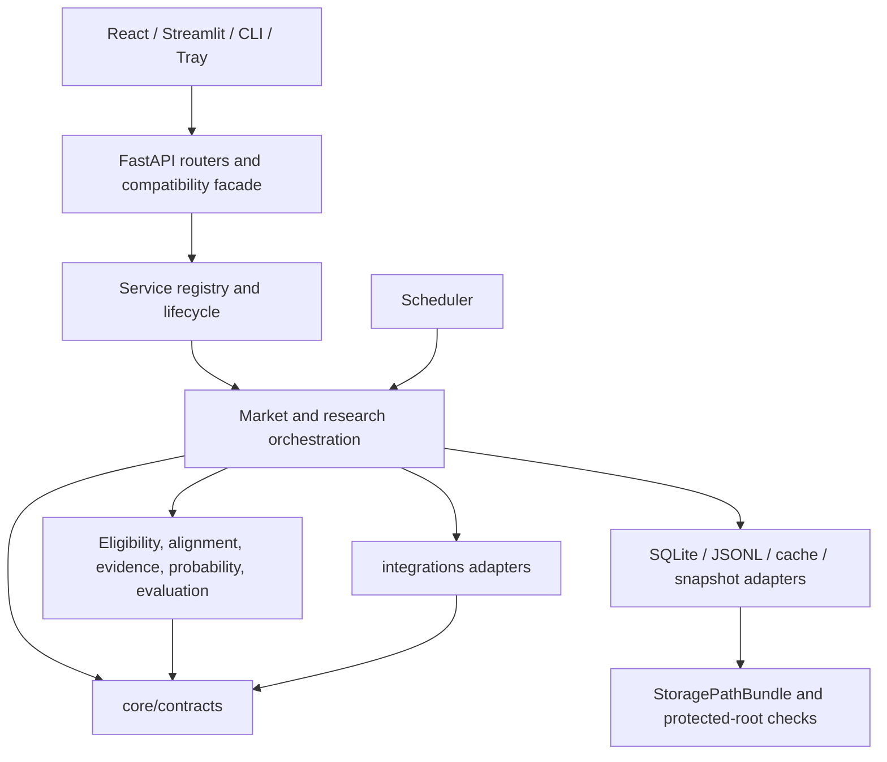

# Architecture consolidation: final validation record

- Branch: `dev`
- Starting checkout for closeout: `dbd4364d3668b4122d8d45af8f709530df24ffad`
- Architecture discovery baseline: `831e048aeda578c98c4ffaa44d805e9329d0b6ec`
- Validation scope: source, fixtures, isolated tests, build, and GitHub Actions. This is not a live-data or production-deployment certification.

## Target and current structure

The repository remains a single Python application with these responsibility anchors:

| Area | Current responsibility |
| --- | --- |
| `server/routers/`, `server/schemas.py` | HTTP boundaries, request/response validation, and route ownership |
| `server/service_registry.py`, `server/lifecycle.py` | Shared service construction, thread-safe initialization, and scheduler lifespan |
| `core/contracts/` | Framework-free shared records and evidence contracts |
| `core/market_candidate_policy.py`, `core/market_provider_factory.py` | Candidate eligibility and provider capability/default construction |
| `core/market_forward_pipeline.py`, `core/research_pipeline.py` | Application orchestration with compatibility entry points |
| `core/research_helpers.py` | Shared serialization, payload, and schedule helpers removed from reverse-dependent mixins |
| `integrations/` | External source parsing and adapter translation to shared contracts |
| `core/storage_config.py` and storage services | Canonical process paths, protected-root checks, and existing SQLite/JSONL behavior |
| `frontend/src/services/api.ts` and shared types | Typed frontend boundary for stable API response fields |
| `app.py`, `pages/`, `ui/` | Retained Streamlit experience and entry path; not merged into the FastAPI UI |

## Before and after evidence

The static AST import scan excludes tests, artifacts, and frontend code. Package-edge counts are import statements, not runtime calls.

| Measurement | Baseline | Current | Interpretation |
| --- | ---: | ---: | --- |
| Production Python modules | 150 | 169 | Added explicit router, contract, policy, and helper modules |
| Module import edges | 431 | 485 | More named boundaries; edge count alone is not a quality score |
| Cyclic strongly connected components | 3 | 0 | Research, edge/probability, and market/scheduler cycles removed |
| `core` → `integrations` import statements | 41 | 27 | Core is less coupled to provider implementations |
| `server.api` fan-out | 28 | 14 | Router/service composition reduced its direct dependencies |
| `server.api.py` size | 1,887 LOC | 93 LOC | Endpoint ownership moved to routers; compatibility facade remains |
| `core/research_pipeline.py` size | 881 LOC | 639 LOC | Shared non-pipeline helpers moved to `core/research_helpers.py` |

`integrations` may depend on `core/contracts` as its neutral output format. The remaining `integrations` → `core` imports include this contract boundary; they are not permission to import application pipelines or server composition. `app.py` and `core/line_notifier.py` remain large, but no evidence justified a risky second split during this task.

## Milestones and commit evidence

The M1–M9 implementation commits and pre-closeout follow-ups are in the closeout starting checkout. The validation and CI-stability follow-ups are listed with M9; the final integrated CI run exercises that complete tree.

| Milestone | Commit | Result |
| --- | --- | --- |
| M1 discovery and baseline | `f0469b0dd1b87c25cbc4e74c4646c680a4e0c3b2` | Complete; CI run `41558572863` passed |
| M2 target architecture | `9bf44657b0e3d56393da31b36873a4a218a1167c` | Complete; CI run `41558960963` passed |
| M3 API/service lifecycle | `f07432341cf5b96d1ed0a5763ff59144e3c478d4` | Complete; CI run `41559972091` passed |
| M4 market/research boundary | `cdcdcc030e63f41668715cd6394357034d22037d` | Complete; CI run `41560927980` passed |
| M5 shared contracts | `eda61a7fa04e0109383fa47b134255e8bfff6b66`, corrected by `af8faef54557047b186eec26cf5ff555e011aa08` | Complete; initial test-file issue was corrected; final integrated CI passed |
| M6 storage boundaries | `fc7cf4137fae2e11dfa578b5560b65e34ef41ef7` | Complete; CI run `41564548717` passed |
| M7 typed UI/API contracts | `17d8dc02c3d49f7a56b86461f7b83f89806f3fbe`, CI follow-up `fb10b5cfe06f5fd09eeb3fdcd795e82eb471d18e` | Complete; final integrated CI passed |
| M8 governance | `c4062336974912b62feb9dccad14cf7a49fa00ab` | Complete; CI run `41567316915` passed |
| M9 delivery and regression | `1fa3cd5d15210937ac6cb8157d2147be1eb306f6` plus follow-ups `dadeeda18948f23535bee59d1e56eaeb04877262`, `458919edfce9eb2d3c594269ac47c25608e3d846`, `dbd4364d3668b4122d8d45af8f709530df24ffad`, `06c9a1720d2e72922788f0d84fca4428f0c54e3d`, `876dcf7164a9fc57d0c10ea94d8544ffa0f5caa9` | Complete; [final CI run `41578348749`](https://github.com/minleu94/sportslottery/actions/runs/41578348749) passed on Windows and Ubuntu |

The final closeout GitHub Actions run (`41578348749`, commit `876dcf7`) built the Python wheel, installed the locked Python and npm dependencies, built the TypeScript/Vite frontend, and ran the full offline `tests` tree on both platforms. Ubuntu reported **629 passed, 18 skipped, 1 warning**; Windows reported **629 passed, 18 skipped, 1 warning**. The skipped tests require explicit local-data or live-network opt-in and were intentionally not enabled in CI. The run also reports non-blocking GitHub Actions runtime and runner-image deprecation notices.

The preceding closeout run (`41577493800`) reported **628 passed, 1 failed, 18 skipped**; the failure was a single timing assertion at 50.96 ms against a 50 ms limit. The measurement was a single SQLite read on a hosted runner. The test now measures five calls and gates the median against the same latency limit; the full test file passed locally, and the corrected test passed in the final cross-platform run. This changes test measurement only, not application runtime behavior.

The earlier integrated run (`41574278277`) reported **628 passed, 18 skipped, 1 warning** on both platforms. The skipped tests require explicit local-data or live-network opt-in and were intentionally not enabled in CI.

For this closeout, the local Windows sandbox completed **577 passed, 18 skipped** in the offline suite after excluding the six `TestClient` modules (`test_line_webhook_server`, `test_market_api`, `test_market_scheduler`, `test_modern_api`, `test_phase1_security`, and `test_phase2_betting_integrity`). The unfiltered local run reached the first loopback-backed `TestClient` and was stopped when that sandbox blocked its socket setup; this was an environment limitation, not a test assertion failure. Hosted Windows and Ubuntu CI ran those modules in the full suite.

## Regression evidence and data boundaries

- API paths, methods, and stable response schemas: `tests/test_api_contract.py`; service singleton/thread-safety: `tests/test_service_registry.py`.
- Frontend response envelopes and additive contract behavior: `tests/test_frontend_api_contracts.py`; production TypeScript/Vite build passed in CI.
- Auth, admin, wallet, ticket lifecycle, scheduler, quota, settlement, and forward metrics remain in the full offline suite; no authorization policy or financial formula was changed by the architecture migrations.
- Market replay: `tests/fixtures/market/mlb_moneyline_replay.json` with `tests/test_market_golden_replay.py` checks the offline MLB moneyline candidate, alignment, fair probability, EV, evidence eligibility, snapshot qualification, and hash. It is a fixture replay, not a claim of live bookmaker alignment.
- Storage: `tests/test_storage_boundaries.py` and the suite's temporary-database tests check canonical paths, alias/Junction handling, protected-root rejection, SQLite transaction, and isolated backup/restore behavior. The current checkout's `data` entry resolves to `F:\Min\Python\Project\SportsLottery_Data`; only the link target metadata was inspected. The database and research files there were not opened or changed.
- External services: no live The Odds API request was made; no credits were consumed. LINE delivery and third-party source availability were not tested.
- Packaging: a local Windows PyInstaller 6.22.3 build completed; the resulting executable and `config/` contents were inspected by filename. The bundle contains exactly the ten allowlisted repository settings/examples and no ignored local API, LINE, or tunnel configuration or lock files. The spec also no longer names a missing Streamlit hidden import. PyInstaller emitted a non-blocking optional SciPy hook warning. The Windows spec packages the legacy Streamlit launcher; the modern Tray/FastAPI product path remains a separate operational entry point.

## Preserved limits and remaining acceptance

1. There is no React component-test runner in `frontend/package.json`; CI validates TypeScript and API contracts. Sheet portal, overlay, scroll, escape, z-index, mobile layout, and keyboard/focus behavior still need a browser-based manual check. Focus trapping/restoration is not claimed by this record.
2. The local database has not been backed up and restored; the existing tests use temporary stores. A sanitized-copy restore and wallet/ledger reconciliation remains an operator acceptance step.
3. Tray restart/recovery, real LINE receive/send, production source freshness, true ahead-of-time event matching, and scheduler operation over an extended Windows session require their deployment environment.
4. Discovery recorded that the release packaging path targets `desktop_launcher.py`/Streamlit while README recommends Tray/FastAPI. This closeout preserves both paths; selecting a single distribution target requires an explicit release decision and executable acceptance of that target.
5. The one-market Golden Replay and cross-platform offline suite establish regression evidence, not predictive advantage or production readiness.
